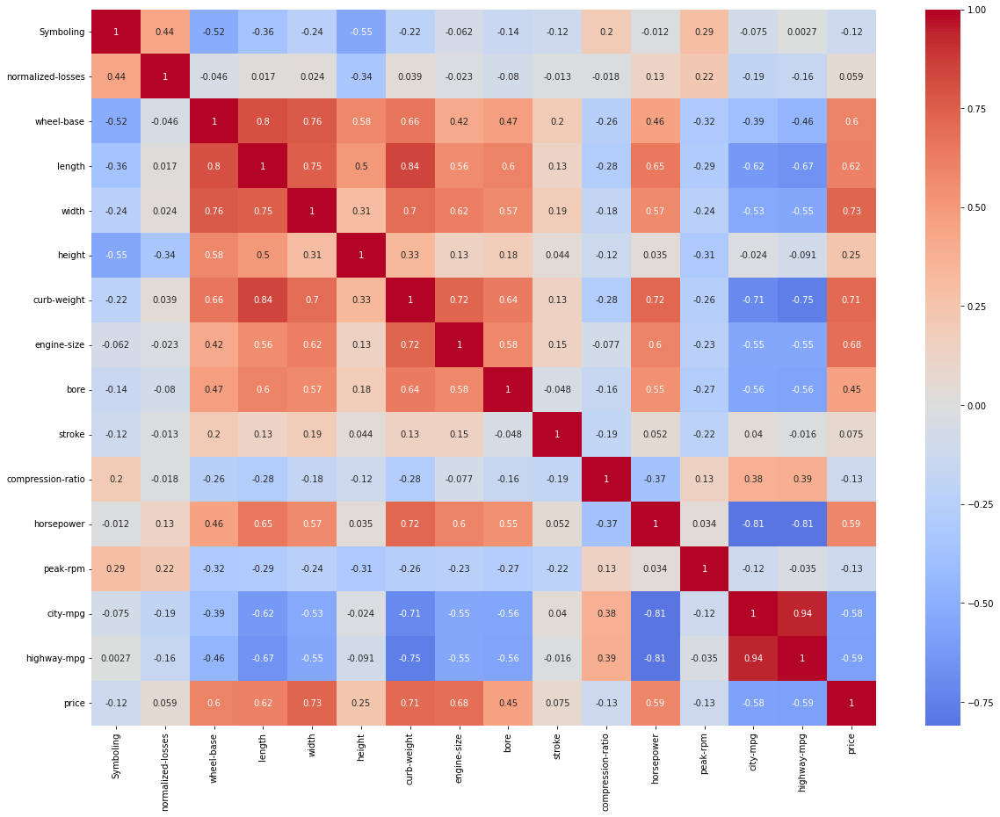
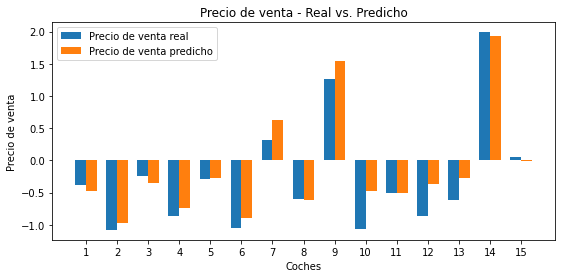
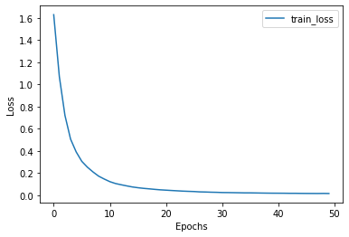

# Automobile Price Regression

**From linear regression to a neural network on the UCI Automobile dataset**

     

## Overview

Price prediction for cars from their technical characteristics, comparing a **linear regression**
baseline with a **Keras neural network**.

## Dataset

[UCI Automobile](https://archive.ics.uci.edu/ml/datasets/automobile) – 205 cars and 26 attributes
(make, fuel type, body style, engine size, horsepower, fuel consumption, insurance risk rating…) plus the price.

## Approach

1. **Missing values** – detection with `isnull()` and correction of the affected columns.
2. **Distributions** – histograms and box plots; transformations to reduce skewness and extreme outliers, then `StandardScaler`.
3. **Feature analysis** – correlation heatmap for numeric features and box plots of price by category.
4. **Split** – training, validation and test sets (about 54 / 26 / 20 %).
5. **Encoding** – one-hot encoding with `DictVectorizer`.
6. **Baseline** – `LinearRegression`.
7. **Neural network** – Dense(64, ReLU) → Dense(32, ReLU) → Dense(1), Adam, MSE loss, 50 epochs.

## Results

<table>
  <tr><td align="center" valign="top"> Correlation heatmap</td><td align="center" valign="top"> Real vs predicted price (test set)</td><td align="center" valign="top"> Neural network training loss</td></tr>
</table>

## How to run

Open the notebook in Colab with the badge above; it downloads the dataset from the UCI repository.

*The notebook is written in Spanish.*

---

Made by <b>Steven Macas</b> — Data Engineer &amp; Data Analyst · <a href="https://gointy.com">gointy.com</a> · <a href="https://www.linkedin.com/in/steven-macas">LinkedIn</a> · <a href="https://github.com/Steven-Macas">GitHub</a>
